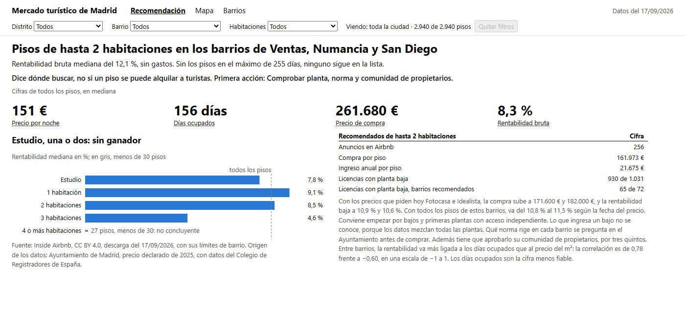
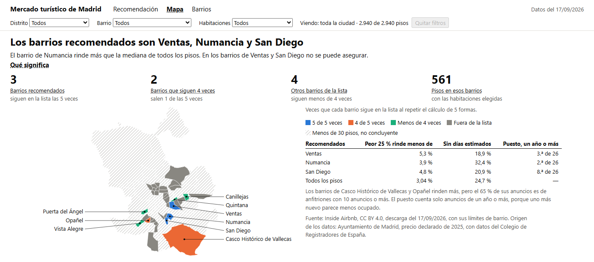

Versión en español: [README.md](README.md)

# Where to look for tourist rental flats in Madrid

A fictional company wants to buy flats in Madrid to let to tourists and needs to know where to start. This analysis answers
that question with public data from Airbnb and Madrid City Council.

**Result:** the first place to look is flats of up to 2 bedrooms in three Madrid neighbourhoods: Ventas (in Ciudad Lineal
district), Numancia and San Diego (both in Puente de Vallecas district). On 17/09/2026 there were 256 such listings among the
2,940 flats analysed. At the median, each flat would cost €161,973 at the official 2025 price and bring in €21,675 a year in
revenue. Calculated flat by flat, the median gross yield is 12.1%, before costs and taxes.

This list says where to look, not whether a specific flat can be let to tourists. That depends on planning rules and has to
be checked flat by flat with the City Council. The occupied days are also an estimate by Inside Airbnb, capped at 255 a year.

If flats at that cap are excluded, the three neighbourhoods drop off the list.

**The purchase price is the official 2025 one, and the market is asking more today.** At the prices on Fotocasa and Idealista,
the median purchase price rises to €171,600 and €182,000, and the gross yield falls to 10.9% and 10.6%. These are asking prices,
so the actual purchase price would be somewhat lower.

[](https://github.com/jleonceo/alquiler-turistico-madrid/actions/workflows/ci.yml)

```bash
git clone https://github.com/jleonceo/alquiler-turistico-madrid.git && cd alquiler-turistico-madrid
pip install -r requirements.txt
python ejecutar.py --completo
```

It requires Python 3.13.

The last command downloads the original 240 MB of data from Inside Airbnb, repeats the whole analysis,
recalculates the figures on this page and runs the tests. The PDF of the executive report needs Microsoft Edge. Without it, the
PDF already in the repository is kept.

## The three deliverables

All three deliverables are in Spanish.

- [Executive report](https://jleonceo.github.io/alquiler-turistico-madrid/informes/informe_ejecutivo.html): three pages for
  management, also available [as a PDF](informes/informe_ejecutivo.pdf).
- [Final report](https://jleonceo.github.io/alquiler-turistico-madrid/informes/informe_final.html): the full analysis, with its
  charts.
- [Dashboard](https://jleonceo.github.io/alquiler-turistico-madrid/informes/cuadro_mando.html): for the team that appraises the
  flats, to compare neighbourhoods.



The four large figures in the image cover all the flats analysed. Those for the three neighbourhoods are in the table on the right.

## Why not all of Madrid

Of the 23,109 Airbnb listings in the city, 14,150 are in the historic centre, where the City Council's RESIDE Plan does not
allow tourist lets in residential buildings. The analysis therefore uses flats outside the centre.
It uses listings from €20 to €1,000 a night. These limits are a judgement call: there are almost no listings below €20 and only
164 above €1,000. That leaves 18,573 of the 18,785 priced listings. The other filters, such as size, minimum stay and occupancy,
then leave the 2,940 flats.

## How the neighbourhoods were chosen

A flat's gross yield is its annual rental income divided by its purchase price. The income is the nightly price multiplied by the
occupied days estimated by Inside Airbnb. The purchase price is calculated from an assumed floor area and the official price per
m² in the neighbourhood.

If the flat were bought 25% below that price, the yield would rise to 16.2%. That discount is an assumption with no data behind it:
against today's asking prices, it would be a reduction of between 29% and 33%.

The neighbourhoods were ranked by yield to see which fell in the top 25%. That ranking changes with the minimum stay and the month
of the price, so the calculation was repeated 12 times with different values. The 9 neighbourhoods that were in the top 25% in more
than half of the repetitions were kept.

The next check was whether those 9 depended on one particular group of listings. The calculation was repeated in five more ways,
for example excluding hosts who have 10 or more listings. The neighbourhoods of Ventas, Numancia and San Diego stayed on the list
all five times.

That is why they are recommended: none of them clearly yields more than the others on the list. Numancia's yield is
above the median for all the flats analysed, but that cannot be said for certain of Ventas and San Diego. The neighbourhoods of Casco Histórico de Vallecas and Opañel yield more than San Diego, but they drop off the list when hosts with
10 or more listings are excluded.



`python ejecutar.py --completo` prints this summary, in Spanish:

```text
Pisos analizados, datos del 17/09/2026: 2.940
Barrios que rinden más: 9
De ellos, siguen en la lista en las 5 repeticiones: Numancia, San Diego y Ventas
Siguen en 4 de 5: Casco Histórico de Vallecas y Opañel

Pisos de hasta 2 habitaciones en los barrios de Numancia, San Diego y Ventas: 256 anuncios
  Precio de compra, en mediana: 161.973 €
  Ingreso al año, en mediana: 21.675 €
  Rentabilidad bruta: 12,1 %
  Rentabilidad bruta si la compra baja un 25 %, un supuesto: 16,2 %
  Con los precios que pide hoy Fotocasa: compra de 171.600 € y rentabilidad bruta de 10,9 %
  Con los precios que pide hoy Idealista: compra de 182.000 € y rentabilidad bruta de 10,6 %
  Rentabilidad de todos los pisos de esos barrios, según el mes del precio y el descuento: de 10,8 % a 15,4 %

Estas cifras coinciden con las del análisis y con las de esta página, en español y en inglés.
```

## Today's purchase price

| Neighbourhood | Official, 2025 deeds | Fotocasa | Idealista |
|---|---|---|---|
| Ventas | €4,133/m² | €4,825/m² | €4,816/m² |
| Numancia | €3,239/m² | €3,432/m² | €3,640/m² |
| San Diego | €3,078/m² | €3,388/m² | €3,489/m² |

The portal prices were checked on 06/11/2026 and are compared only for these three neighbourhoods.

## How it is built

Fourteen Python scripts do the work, from download to the three deliverables, covering data quality checks, cleaning, joins,
exploration, metrics and reports. The three deliverables take their figures from a single file,
[indicadores.json](informes/indicadores.json).
[A second script](scripts/rehacer_portada.py) redoes the choice of neighbourhoods and the medians on this page from a local table,
sharing no code with the analysis. The tests also recalculate the metrics by a separate route.

The detail, in Spanish, is in [the method](docs/metodo.md), [the business rules](docs/reglas_de_negocio.md),
[the data criteria](docs/criterios_de_datos.md) and [the data](docs/datos.md).

## The data

| Source | What it provides | Licence | Where it is |
|---|---|---|---|
| [Inside Airbnb](https://insideairbnb.com/get-the-data/), Madrid | listings, calendar, reviews and neighbourhood boundaries | [CC BY 4.0](https://creativecommons.org/licenses/by/4.0/) | downloaded separately |
| [Madrid City Council](https://datos.madrid.es/) | 2025 price and floor area, sales, licences, historic centre and points of interest | reuse with attribution | `data/raw/externos/` |
| Colegio de Registradores de España | origin of the price and floor area published by the City Council | cited with the City Council | `data/raw/externos/` |
| [Fotocasa](https://www.fotocasa.es/fotocasa-life/sector/evolucion-del-precio-de-la-vivienda-en-madrid/) and [Idealista](https://www.idealista.com/maps/madrid/) | today's asking price per m² in the three neighbourhoods, for comparison only | source cited | `config/fuentes/precios_de_mercado.json` |

Inside Airbnb's data is not included because [its policy](https://insideairbnb.com/data-policies/) asks people not to republish
it. It is downloaded from their website when the analysis is repeated.

## Limits

- The storey and access of each flat are unknown.
- If only listings a year old or older are used, San Diego falls to 8th out of 26 neighbourhoods by yield.
- Each flat's floor area is an assumption: 50 m² for up to 1 bedroom, 65 m² for 2 and more for 3 or more. So we cannot say which
  yields more: a studio, a one-bedroom flat or a two-bedroom flat.
- Only flats with estimated occupancy count, meaning those with reviews in the last year. Flats that are not letting are left out,
  which may push the yield up.
- It has not been measured whether another price range would change the neighbourhoods.
- The yield excludes costs, taxes, service charges and commissions.
- The neighbourhoods were chosen using the price declared in 2025. It has not been measured whether today's prices would change them.
- A rental listing does not mean the flat is for sale.
- Repeating the full analysis depends on Inside Airbnb still offering these downloads.

## Related repositories

- [accident-intelligent-agent](https://github.com/jleonceo/accident-intelligent-agent): another analysis of Madrid open data,
  the 2020 traffic accidents.
- [de-datos-en-bruto-a-decisiones](https://github.com/jleonceo/de-datos-en-bruto-a-decisiones): from a raw sales file to a
  dashboard.
- [lead-scoring-ml](https://github.com/jleonceo/lead-scoring-ml): a complete machine learning case for scoring sales leads.
