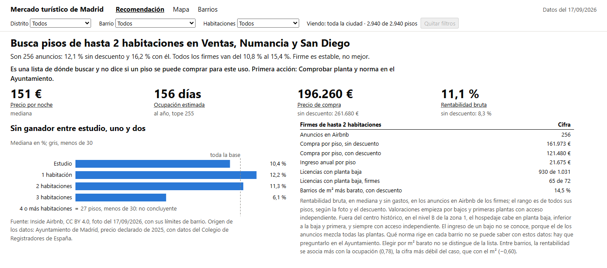
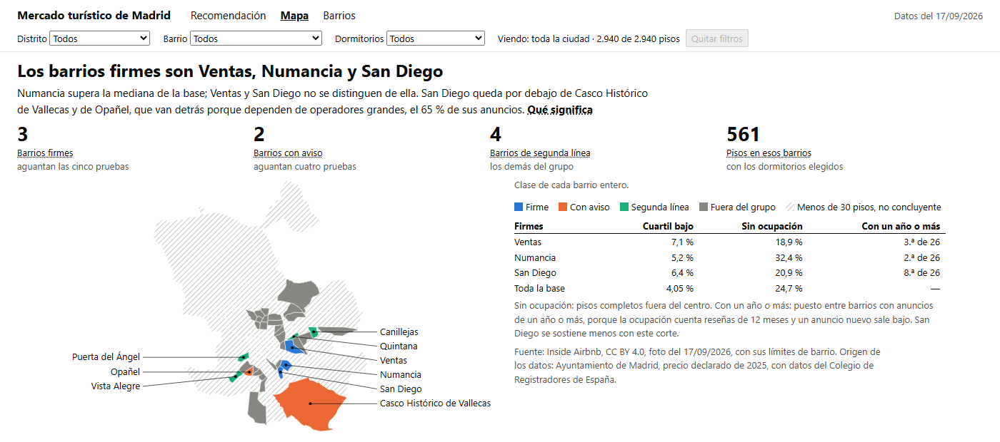

English version: [README.en.md](README.en.md)

# Dónde buscar pisos para alquiler turístico en Madrid

Una empresa ficticia quiere comprar pisos en Madrid para alquilarlos a turistas y necesita saber por dónde empezar. Este
análisis responde con datos públicos de Airbnb y del Ayuntamiento de Madrid.

**Resultado:** conviene empezar por pisos de hasta 2 habitaciones en tres barrios de Madrid: Ventas (distrito de Ciudad
Lineal), Numancia y San Diego (los dos en Puente de Vallecas). El 17/09/2026 había 256 anuncios con esas condiciones, de los 2.940 pisos
analizados. En mediana, cada piso costaría 161.973 € al precio oficial de 2025 e ingresaría 21.675 € al año. Es una
rentabilidad bruta del 12,1 %, antes de gastos e impuestos.

Esta lista dice dónde buscar, pero no si un piso concreto se puede alquilar a turistas. Eso depende de la normativa
urbanística y hay que comprobarlo piso a piso en el Ayuntamiento. Los días ocupados son además una estimación de
Inside Airbnb, con un tope de 255 al año. Si se quitan los pisos que llegan a ese tope, los tres barrios salen de la lista.

[](https://github.com/jleonceo/alquiler-turistico-madrid/actions/workflows/ci.yml)

```bash
git clone https://github.com/jleonceo/alquiler-turistico-madrid.git && cd alquiler-turistico-madrid
pip install -r requirements.txt
python ejecutar.py --completo
```

Hace falta Python 3.13. El último comando descarga los 240 MB originales de Inside Airbnb, repite todo el análisis en unos cinco
minutos, recalcula las cifras de esta página y ejecuta las pruebas.

## Las tres entregas

- [Informe ejecutivo](https://jleonceo.github.io/alquiler-turistico-madrid/informes/informe_ejecutivo.html): tres páginas para
  la dirección, también [en PDF](informes/informe_ejecutivo.pdf).
- [Informe final](https://jleonceo.github.io/alquiler-turistico-madrid/informes/informe_final.html): el análisis completo, con
  sus gráficos.
- [Cuadro de mando](https://jleonceo.github.io/alquiler-turistico-madrid/informes/cuadro_mando.html): para que el equipo que
  valora los pisos compare los barrios.



## Por qué no se mira todo Madrid

De los 23.109 anuncios de Airbnb en la ciudad, 14.150 están en el centro histórico, donde el Plan RESIDE del Ayuntamiento
no admite pisos turísticos en edificios residenciales. Por eso el análisis usa los pisos de fuera del centro.

Se usan los anuncios de 20 a 1.000 € por noche. Esos topes son una decisión: por debajo de 20 € casi no hay anuncios y por
encima de 1.000 € solo hay 164. Dentro quedan 18.573 de los 18.785 anuncios con precio, suficientes para el análisis.

## Cómo se eligieron los barrios

La rentabilidad bruta de un piso es su ingreso anual dividido entre lo que costaría comprarlo. El ingreso se calcula con el precio por
noche y los días ocupados que estima Inside Airbnb. El precio de compra se calcula con una superficie supuesta y el precio
oficial del m² del barrio. Si se comprara un 25 % por debajo de ese precio, la rentabilidad subiría al 16,2 %.

Los barrios se ordenaron por rentabilidad y se miró cuáles quedaban en el 25 % más rentable. Ese orden cambia con las
condiciones del cálculo, como la estancia mínima o el mes del precio, así que se repitió con 12 combinaciones. Se quedaron los 9
barrios que salieron en ese 25 % en más de la mitad de ellas.

Después se comprobó si esos 9 barrios dependían de un grupo concreto de anuncios. El cálculo se repitió cinco veces más, por
ejemplo sin los anfitriones que tienen 10 anuncios o más. Ventas, Numancia y San Diego siguieron en la lista las cinco veces. Se recomiendan por esa estabilidad: ninguno rinde claramente más que los otros barrios de la lista. Numancia supera la mediana
de todos los pisos analizados, mientras que Ventas y San Diego podrían no diferenciarse de ella.

Casco Histórico de Vallecas y Opañel rinden más que San Diego, pero salen de la lista si se quitan los anfitriones con 10 anuncios
o más.



`python ejecutar.py --completo` imprime este resumen:

```text
Pisos analizados, datos del 17/09/2026: 2.940
Barrios que rinden más: 9
De ellos, siguen en la lista en las 5 repeticiones: Numancia, San Diego y Ventas
Siguen en 4 de 5: Casco Histórico de Vallecas y Opañel

Pisos de hasta 2 habitaciones en Numancia, San Diego y Ventas: 256 anuncios
  Precio de compra, en mediana: 161.973 €
  Ingreso al año, en mediana: 21.675 €
  Rentabilidad bruta: 12,1 %
  Rentabilidad bruta si la compra baja un 25 %: 16,2 %
  Rentabilidad de todos los pisos de esos barrios, según el mes del precio y el descuento: de 10,8 % a 15,4 %

Estas cifras coinciden con las del análisis y con las de los dos README.
```

## Cómo está hecho

Trece scripts de Python hacen el trabajo, desde la descarga hasta las tres entregas: calidad, corrección, cruces, exploración,
indicadores e informes. Las tres entregas toman sus cifras de un único fichero, [indicadores.json](informes/indicadores.json).
[Un segundo script](scripts/rehacer_portada.py), que no comparte código con el análisis, recalcula las cifras de esta página.

El detalle está en [el método](docs/metodo.md), [las reglas de negocio](docs/reglas_de_negocio.md),
[los criterios de datos](docs/criterios_de_datos.md) y [los datos](docs/datos.md).

## Los datos

| Fuente | Qué aporta | Licencia | Dónde está |
|---|---|---|---|
| [Inside Airbnb](https://insideairbnb.com/get-the-data/), Madrid | anuncios, calendario, reseñas y límites de barrio | [CC BY 4.0](https://creativecommons.org/licenses/by/4.0/) | se descarga aparte |
| [Ayuntamiento de Madrid](https://datos.madrid.es/) | precio y superficie de 2025, ventas, licencias, centro histórico y puntos de interés | reutilización con cita | `data/raw/externos/` |
| Colegio de Registradores de España | origen del precio y la superficie que publica el Ayuntamiento | se cita junto al Ayuntamiento | `data/raw/externos/` |

Los datos de Inside Airbnb no están aquí porque  pide no volver a
publicarlos. Se descargan de su web al repetir el análisis.

## Límites

- No se conoce la planta ni el acceso de cada piso.
- Con los anuncios de un año o más, San Diego baja al puesto 8 de 26 en rentabilidad.
- No se conoce la superficie real, así que no se puede decir qué rinde más: un estudio, una habitación o dos.
- No se ha medido si otro rango de precio cambiaría los barrios.
- La rentabilidad no incluye gastos, impuestos, comunidad ni comisiones.
- El precio de compra es el declarado en 2025.
- Un anuncio de alquiler no significa que ese piso esté en venta.
- Repetir el análisis completo depende de que Inside Airbnb siga ofreciendo estas descargas.
- Las pruebas solo han pasado en Windows.
- Las pruebas automáticas de GitHub no se han ejecutado todavía.

## Repositorios relacionados

- [accident-intelligent-agent](https://github.com/jleonceo/accident-intelligent-agent): otro análisis con datos abiertos de
  Madrid, los accidentes de tráfico de 2020.
- [de-datos-en-bruto-a-decisiones](https://github.com/jleonceo/de-datos-en-bruto-a-decisiones): de un fichero de ventas sin tratar
  a un cuadro de mando.
- [lead-scoring-ml](https://github.com/jleonceo/lead-scoring-ml): un caso completo de machine learning para puntuar contactos
  comerciales.
